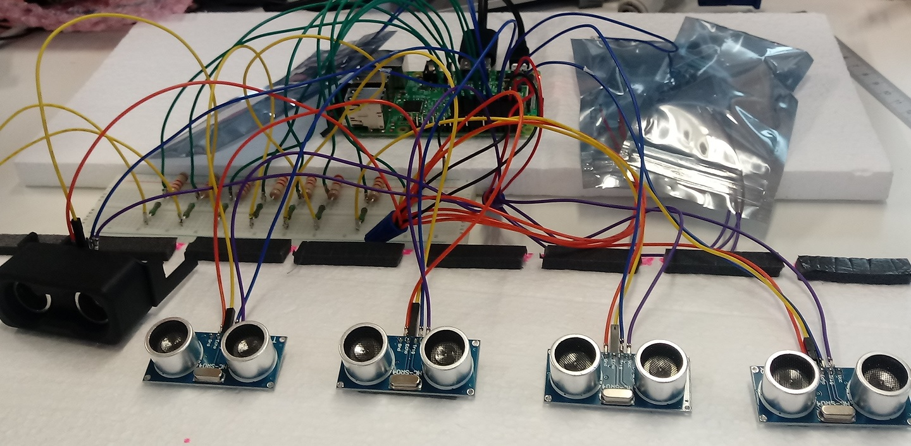
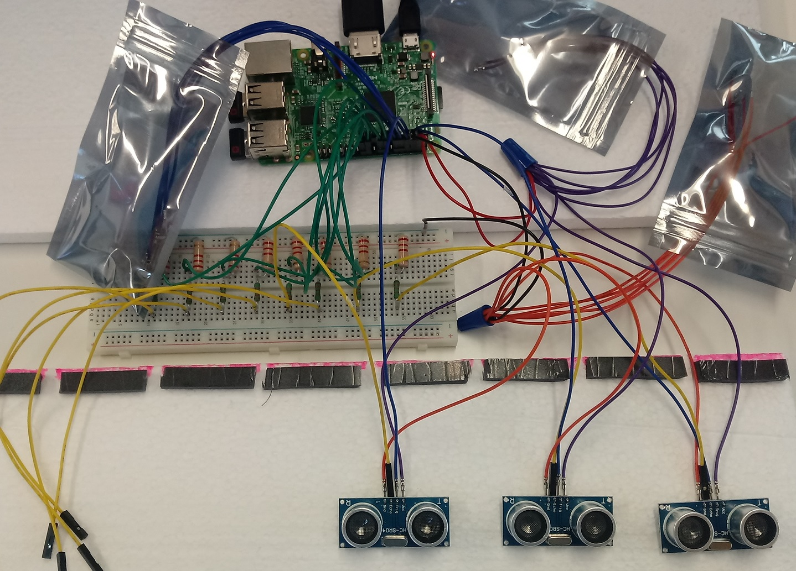
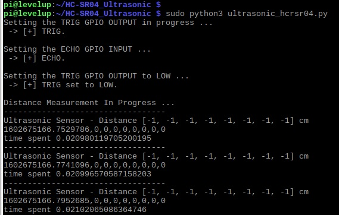

# 8 × Ultrasonic Distance Sensors HC-SR04 — Raspberry Pi

Measures distance to objects with **eight HC-SR04 ultrasonic sensors** driven from a Raspberry Pi's GPIOs. The sensors are triggered **one after another** to avoid acoustic crosstalk, and a **watchdog timeout** caps each measurement so the full scan of all 8 sensors stays fast.

<p align="center">
  
</p>

## How It Works

1. Send a 10 µs pulse on the sensor's **TRIG** pin. The HC-SR04 emits 8 bursts at 40 kHz.
2. Time how long the **ECHO** pin stays high: that's the round trip of the sound wave.
3. Distance = pulse duration × 34 300 cm/s ÷ 2 (= duration × 17 150).
4. A **watchdog** of 2.5 ms stops waiting if no echo returns. That covers the ~30 cm working range (60 cm round trip ≈ 1.75 ms) and reports `-1` for "no object".
5. Repeat for all 8 sensors and print the distances, plus one CSV line per scan.

## Wiring (BCM numbering)

| Sensor | 1 | 2 | 3 | 4 | 5 | 6 | 7 | 8 |
|--------|---|---|---|---|---|---|---|---|
| TRIG | 2 | 3 | 4 | 14 | 15 | 18 | 17 | 27 |
| ECHO | 22 | 23 | 24 | 10 | 9 | 11 | 25 | 8 |

> The HC-SR04 ECHO output is 5 V. Use a voltage divider to bring it down to the Pi's 3.3 V inputs.

## Setup

<p align="center">
  
</p>

## Usage

```bash
pip3 install -r requirements.txt
sudo python3 src/ultrasonic_hcrsr04.py
```

<p align="center">
  
</p>

## Repository Structure

```
.
├── src/
│   ├── ultrasonic_hcrsr04.py   # Measurement loop
│   └── hcrsr04_lib.py          # GPIO setup helpers
├── photos/                     # Setup and output
└── requirements.txt
```

## Tech Stack

Python 3 · RPi.GPIO · HC-SR04 · Raspberry Pi

## Author

**Akram M'Tir**, [@amtir](https://github.com/amtir)
